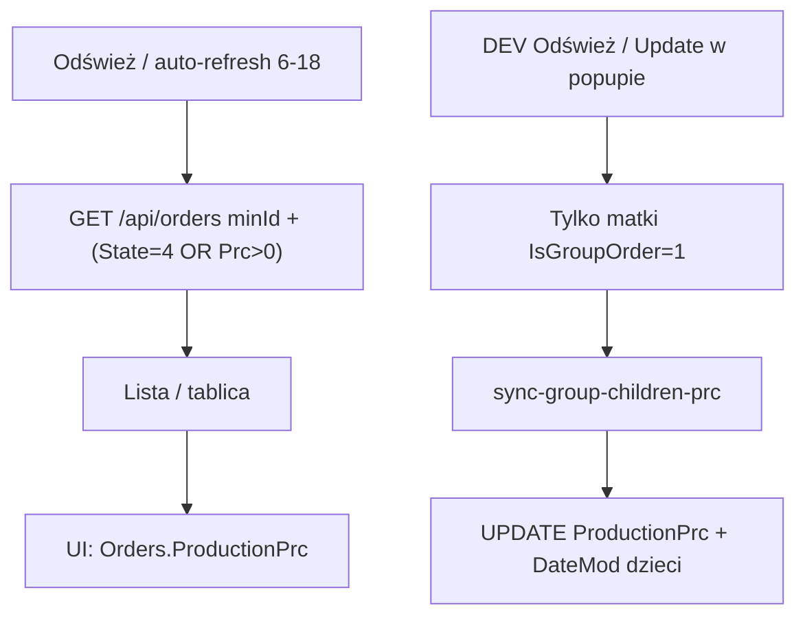

# Tajhmajster Production Tracker (Netlify)

Monitor produkcji dla OptiCut / LIGNUM LINK: lista zleceń, tablica kafelków, status `%`, sync `%` podzleceń z checklisty formatek.

**Wersja UI:** `APP_VERSION` w [`config/project.ts`](config/project.ts) (np. `V.1.07`).

## Stack

| Warstwa | Technologia |
|---------|-------------|
| FE | Vite + React + TypeScript (`src/`) |
| API | Netlify Functions (`netlify/functions/`) |
| Lokalnie | `npm run dev` → Vite `:5173` + `scripts/local-api.mjs` `:8787` |
| DB | MySQL (`MYSQL_*` w `.env` / Netlify env) |
| Auth | `MONITOR_ACCESS_TOKEN` (Bearer / `x-monitor-token`) |

## Uruchomienie

```bash
cp .env.example .env   # uzupełnij MYSQL_* i MONITOR_ACCESS_TOKEN
npm install
npm run dev            # web + local-api
```

Deploy: Netlify (`netlify.toml` — `dist` + functions, redirect `/api/*` → `/.netlify/functions/:splat`).

**Uwaga:** `local-api` ładuje handlery lazy (mtime). Po dużych zmianach API zrestartuj `npm run dev`.

## Konfiguracja (wszystkie zmienne w jednym miejscu)

**Plik:** [`config/project.ts`](config/project.ts)

| Stała | Znaczenie |
|-------|-----------|
| `APP_VERSION` | Napis wersji w prawym górnym rogu |
| `AUTO_REFRESH_MS` | Interwał auto-odświeżania (`60_000` = 60 s) |
| `AUTO_REFRESH_HOUR_FROM` / `TO` | Auto-refresh tylko w tych godzinach lokalnych (domyślnie **6–18**); poza oknem pauza (oszczędność DB) |
| `ZERO_PCT_IDLE_DROP_MS` | Widok 1: zlecenie z **0%** spada w dół po tym czasie od wysłania (`24h`) |
| `ORDER_STATE_ON_PRODUCTION` | Realizacja = **4** (widać także przy 0%) |
| `ORDER_STATE_REJECTED` | Odrzucone = **2** (ciemny bordowy + biały tekst) |
| `MIN_PRODUCTION_ORDER_ID` | Lista / tablica / sync od `Orders.Id` ≥ tej wartości (`8700`) |
| `SYNC_PRODUCTIONS_FROM_DATE` | Opcjonalny filtr daty dla kandydatów syncu (`''` = wyłączony) |
| `PRODUCTION_TEST_GROUP_IDS` | Grupy Production test (DEV) |
| `CHILD_PRODUCTIONS_*` | Testowe `Productions` dla dzieci |
| `ANIM_DEMO_ORDER_ID` | DEV → Play animation |
| `SYNC_PRC_BATCH_SIZE` | Równoległe syncy `%` przy Odśwież (DEV) |

Po zmianie FE: odśwież przeglądarkę. Po zmianie używanej przez API: zrestartuj `npm run dev`.

## Statusy zleceń (OptiCut)

| State | Znaczenie |
|------:|-----------|
| -1 | Edycja/korekta |
| 1 | Pobrane |
| 2 | **Odrzucone** → UI bordowy |
| 3 | Wycena |
| 4 | **Realizacja** |
| 5 | Do odbioru (status w systemie) |
| 10 | Oczekiwanie na wpłatę |

Dodatkowo: **`FlagOut = 1`** = wydane/dostarczone (znika z sekcji „Do odbioru” na tablicy).

## Widoczność na monitorze

`Orders.Id >= MIN_PRODUCTION_ORDER_ID` **oraz**:

- `State = 4` (Realizacja) — także przy `ProductionPrc = 0`, **albo**
- `ProductionPrc > 0` — dowolny inny status (np. Pobrane z już naliczonym `%`)

API: `GET /api/orders?minId=8700` (bez wymuszania samego `state=4`).

## Reguła aktualizacji %

| Typ | Zachowanie |
|-----|------------|
| **Grupowe** (`IsGroupOrder = 1`) | Sync liczy `%` **dzieci** z checklisty matki (`QuantityStamp` / `Quantity` → `OrdersPieces.IdOrderParent`) i zapisuje `Orders.ProductionPrc` + `DateMod`. **Matki nie nadpisujemy.** |
| **Pojedyncze** (np. `8727`) | **Bez syncu** — OptiCut sam ustawia `ProductionPrc`; monitor tylko **odczytuje**. |



- Kandydaci syncu: `GET /api/orders-to-sync-prc` — **tylko matki grup** (State=4, Id≥min)
- Zapis: `GET /api/sync-group-children-prc?groupId=…`

## Widoki UI (header)

W navbarze są **dwa** przyciski z ikonami:

| Przycisk UI | Wewnętrznie | Opis |
|-------------|-------------|------|
| **Widok 1** (ikona listy) | `view === 1` | Tabela: nr + pasek `%` + opis |
| **Widok 2** (ikona kafelków) | `view === 3` | Tablica produkcji + Do odbioru |
| _(ukryty)_ | `view === 2` | Stara gęsta tabela OptiCut — **logika w kodzie zostaje**, brak przycisku |

### Widok 1 — sortowanie

Od góry:

1. W toku (`0% < % < 100%`) — wg ostatniej aktywności (`DateMod` / `Productions.DateAdd` + lokalne wykrycie wzrostu `%`)
2. Świeże **0%** (wysłane &lt; `ZERO_PCT_IDLE_DROP_MS`, zwykle 24 h od `DateExecution`)
3. Stare **0%** (bez ruchu dłużej niż 24 h → spadają)
4. Ukończone (`≥ 100%`)

State **2** = bordowy wiersz, biały tekst. Responsywne karty na telefonie.

### Widok 2 (tablica, `view === 3`)

- Pełna szerokość, **białe tło**
- Tylko kafelki z **`ProductionPrc > 0`**
- **Produkcja (góra):** `0% < % < 100%` — duże numery, animacja wzrostu `%` jak w widoku 1
- **Grupa:** matka + podzlecenia, szara „chmura”/poświata, niebieska ikona grupy na kafelku matki; podzlecenia ~80% wysokości matki, 1 rząd na dużym ekranie
- **Do odbioru (prawy dół):** `ProductionPrc ≥ 100` **i** `FlagOut = 0`; nagłówek u góry (samochód + strzałka →), jednakowe mniejsze/większe kafelki **tylko z numerem** (bez napisu 100%)
- State **2** = bordowy kafelek, biały tekst
- Responsywność: tablet / telefon

## Header / UX

- Logo LIGNUM LINK, tytuł **Production**, Odśwież
- Środek: Widok 1 / Widok 2 (z ikonami)
- Prawo: flagi PL/EN/SL (SVG), Wyloguj, `APP_VERSION`
- **DEV** (niewidoczny hit-area): tylko duże ekrany (≥1100px), przy prawej krawędzi; tablet/telefon — ukryty
- DEV: Stop/Start refresh, countdown, Production test, Zlecenia do aktualizacji, Play animation, meta „N zleceń”

### Auto-refresh

- Interwał: `AUTO_REFRESH_MS` (60 s)
- Tylko **6:00–18:00** czasu lokalnego (`isAutoRefreshHours`)
- Poza oknem / Stop refresh: licznik `—`; **ręczny Odśwież** zawsze działa
- Auto-refresh = **tylko odczyt** (bez zapisu `%`); zapis `%` dzieci tylko DEV + Odśwież w widoku 1 / Update w popupie

## DEV mode

| Funkcja | Zachowanie |
|---------|------------|
| Production test | Grupy z `PRODUCTION_TEST_GROUP_IDS` |
| Zlecenia do aktualizacji | Popup tylko **grup**; Update per matka |
| Odśwież (Widok 1 + DEV) | Sync `%` dzieci kandydatów, potem reload |
| Stop refresh | Pauza timera (session w przeglądarce; działa na Netlify) |
| Play animation | Animacja paska na `ANIM_DEMO_ORDER_ID` |
| Checkbox Productions | INSERT/UPDATE `Productions` dzieci (`CHILD_PRODUCTIONS_*`) |

## Struktura katalogów

```
config/
  project.ts                 # ★ zmienne projektu
src/
  App.tsx                    # widoki, DEV, refresh 6–18
  components/
    OrderList.tsx            # widok 1
    ProductionBoardView.tsx  # widok 2 (UI) / view===3
    OrdersTableView.tsx      # ukryty stary widok 2
    OrdersToSyncModal.tsx
    PercentBar.tsx
    …
  lib/
    api.ts
    orderDisplay.ts          # sort, klastry tablicy, FlagOut, rejected
    recentGains.ts           # lokalne wykrycie wzrostu %
    percent.ts
  i18n/
netlify/functions/
  orders.ts                  # minId + (State=4 OR Prc>0), DateMod, FlagOut, LastActivityAt
  order-detail.ts
  sync-group-children-prc.ts # UPDATE ProductionPrc + DateMod
  orders-to-sync-prc.ts      # preview grup (DateAdd opcjonalny)
  _lib/db.ts, auth.ts
scripts/
  local-api.mjs
  dev.mjs
```

## Model danych (kluczowe)

- **Orders**: `Id`, `IdParent`, `IsGroupOrder`, `State`, `ProductionPrc`, `DateMod`, `DateExecution`, `FlagOut`
- **Productions**: `OrderId`, `Symbol`, `ProductionPercent`, `DateAdd`
- **ProductionsSocketsCheckLists**: `IdOrder` = matka, `Quantity` / `QuantityStamp`
- **OrdersPieces**: `IdOrderParent` = Id **dziecka**

Formuła `%` dziecka (sync grup):

```
SUM(QuantityStamp) / SUM(Quantity) * 100
```

## API (skrót)

| Endpoint | Rola |
|----------|------|
| `GET /api/orders` | Lista; przy `minId` filtr: Realizacja **lub** `% > 0`; zwraca też dzieci grup, `FlagOut`, `LastActivityAt` |
| `GET /api/order-detail?id=` | Detal |
| `GET /api/orders-to-sync-prc` | Preview **grup** do syncu `%` |
| `GET /api/sync-group-children-prc` | Zapis `%` (+ `DateMod`) dzieci jednej grupy |

## Zasady przy dalszym developmencie

1. Nie syncować pojedynczych zleceń — tylko odczyt `ProductionPrc`.
2. Nie mieszać `%` matki ze średnią dzieci.
3. Sync formatek: checklista matki → `OrdersPieces.IdOrderParent`.
4. Nowe trasy API → `scripts/local-api.mjs` (`ROUTE_MAP`).
5. i18n: klucze w PL/EN/SL; flagi = SVG (`FlagIcon.tsx`).
6. Stary widok tabeli OptiCut (`view === 2`) — nie usuwać logiki bez decyzji; w UI ukryty.

## Powiązane

- `production_tajhmajster_project_readme.md` — szersza architektura produkcji / sockety OptiCut.
