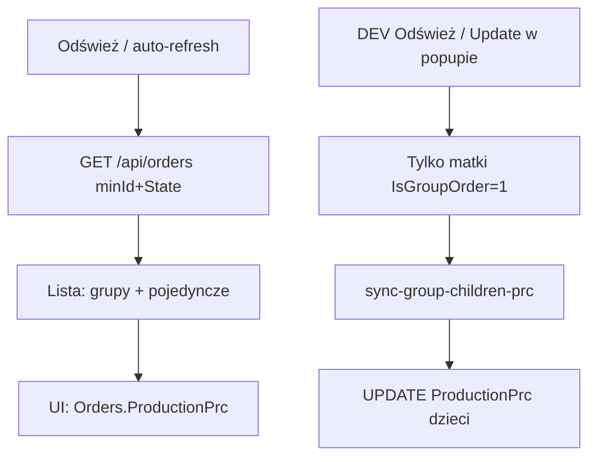

# Tajhmajster Production Tracker (Netlify)

Monitor produkcji dla OptiCut / LIGNUM LINK: lista zleceń, status `%`, sync `%` podzleceń z checklisty formatek.

## Stack

| Warstwa | Technologia |
|---------|-------------|
| FE | Vite + React + TypeScript (`src/`) |
| API | Netlify Functions (`netlify/functions/`) |
| Lokalnie | `npm run dev` → Vite `:5173` + `scripts/local-api.mjs` `:8787` |
| DB | MySQL (`MYSQL_*` w `.env` / Netlify env) |
| Auth | `MONITOR_ACCESS_TOKEN` (Bearer / `x-monitor-token`) |

## Uruchomienie

```bash
cp .env.example .env   # uzupełnij MYSQL_* i MONITOR_ACCESS_TOKEN
npm install
npm run dev            # web + local-api
```

Deploy: Netlify (`netlify.toml` — `dist` + functions, redirect `/api/*` → `/.netlify/functions/:splat`).

**Uwaga:** `local-api` ładuje handlery lazy (mtime). Po dużych zmianach routingu zrestartuj `npm run dev`.

## Konfiguracja (wszystkie zmienne w jednym miejscu)

**Plik:** [`config/project.ts`](config/project.ts)

Tam ustawiasz m.in. interwał odświeżania, min. Id, grupy testowe, animację DEV.

| Stała | Znaczenie (przykład) |
|-------|----------------------|
| `APP_VERSION` | Napis wersji w prawym górnym rogu (`V.1.06`) |
| `AUTO_REFRESH_MS` | Auto-odświeżanie: `30_000` = 30 s, `60_000` = 60 s |
| `ORDER_STATE_ON_PRODUCTION` | Stan „na produkcji” (`4`) |
| `MIN_PRODUCTION_ORDER_ID` | Lista + sync grup od tego `Orders.Id` (`8700`) |
| `SYNC_PRODUCTIONS_FROM_DATE` | Opcjonalny filtr `Productions.DateAdd` (`''` = wyłączony) |
| `PRODUCTION_TEST_GROUP_IDS` | Grupy Production test (`9121`, `9124`) |
| `CHILD_PRODUCTIONS_GROUP_IDS` / `SYMBOL` | Testowe wiersze `Productions` dla dzieci |
| `ANIM_DEMO_ORDER_ID` | DEV → Play animation (`9039`) |

Po zmianie FE: odśwież przeglądarkę. Po zmianie używanej przez API: zrestartuj `npm run dev`.

## Reguła aktualizacji % (ważne)

Zakres: zlecenia **wysłane na produkcję** (`State = ORDER_STATE_ON_PRODUCTION`) oraz **`Orders.Id >= MIN_PRODUCTION_ORDER_ID`**.

| Typ zlecenia | Co robi monitor |
|--------------|-----------------|
| **Grupowe** (`IsGroupOrder = 1`) | Sync liczy `%` **dzieci** z checklisty matki (`QuantityStamp` / `Quantity` → `OrdersPieces.IdOrderParent`) i zapisuje `Orders.ProductionPrc` dzieci. **Matki nie nadpisujemy.** |
| **Pojedyncze** (np. `8727`, bez grupy) | **Bez syncu** — OptiCut / system produkcji sam ustawia `Orders.ProductionPrc`. Monitor przy Odśwież **tylko odczytuje** tę wartość z DB. |



Implementacja:

- Lista: `GET /api/orders?state=4&minId=8700` — grupy + standalony ze ścieżką `Productions`
- Kandydaci syncu: `GET /api/orders-to-sync-prc` — **wyłącznie matki grup**
- Zapis: `GET /api/sync-group-children-prc?groupId=…` — tylko dzieci tej grupy

## Struktura katalogów

```
config/
  project.ts              # ★ WSZYSTKIE zmienne sterujące projektem
src/
  App.tsx                 # widoki 1/2/3, DEV, refresh/sync
  components/             # UI
  lib/api.ts              # klient /api/*
  lib/orderDisplay.ts     # grupy matka/dzieci, pickBoardOrders
  lib/percent.ts
  i18n/
netlify/functions/
  orders.ts
  order-detail.ts
  sync-group-children-prc.ts
  orders-to-sync-prc.ts
  _lib/db.ts, auth.ts
scripts/
  local-api.mjs
  dev.mjs
```

## Model danych (kluczowe)

- **Orders**: `Id`, `IdParent`, `IsGroupOrder`, `State` (4 = Realizacja), `ProductionPrc`
- **Productions**: ścieżka (`OrderId`, `Symbol`, `ProductionPercent`, `DateAdd`)
- **ProductionsSocketsCheckLists**: checklista (`IdOrder` = matka, `Quantity` / `QuantityStamp`)
- **OrdersPieces**: `IdOrderParent` = Id **dziecka**

Formuła `%` dziecka (sync grup):

```
SUM(QuantityStamp) / SUM(Quantity) * 100
```

## Widoki UI

| Widok | Opis |
|-------|------|
| 1 | Tabela: nr + Status `%` + opis; grupy z odstępem 15px |
| 2 | Gęsta tabela (jak Orders / OptiCut) |
| 3 | Karty; klik → Widok 1 + scroll do grupy |

Header: logo, **Production**, Odśwież (+ odliczanie w DEV), Widok 1/2/3 (środek), flagi + DEV + Wyloguj.

Licznik „N zleceń” — tylko w DEV.

## DEV mode

| Funkcja | Zachowanie |
|---------|------------|
| Production test | Tylko DEV; grupy z `PRODUCTION_TEST_GROUP_IDS` |
| Zlecenia do aktualizacji | Popup **tylko grup**; Update per matka |
| Odśwież (Widok 1 + DEV) | Sync `%` dzieci wszystkich kandydatów-grup, potem reload listy (pojedyncze = odczyt) |
| Auto-refresh | Tylko odczyt listy — **bez** zapisu `%` |
| Play animation | Test animacji paska na `ANIM_DEMO_ORDER_ID` |
| Checkbox Productions | Opcjonalnie INSERT/UPDATE `Productions` dzieci (grupy z `CHILD_PRODUCTIONS_*`) |

## API (skrót)

| Endpoint | Rola |
|----------|------|
| `GET /api/orders` | Lista; `state`, `minId`, `groupId`, `limit`, … |
| `GET /api/order-detail?id=` | Detal |
| `GET /api/orders-to-sync-prc` | Preview **grup** do syncu `%` |
| `GET /api/sync-group-children-prc` | Zapis `%` dzieci jednej grupy |

## Zasady przy dalszym developmencie

1. Nie syncować pojedynczych zleceń — tylko odczyt `ProductionPrc`.
2. Nie mieszać `%` matki ze średnią dzieci.
3. Sync formatek: checklista matki → `OrdersPieces.IdOrderParent`.
4. Nowe trasy API → `scripts/local-api.mjs` (`ROUTE_MAP`).
5. i18n: klucze w PL/EN/SL; flagi = SVG (`FlagIcon.tsx`).

## Powiązane

- `production_tajhmajster_project_readme.md` — szersza architektura produkcji / sockety OptiCut.
